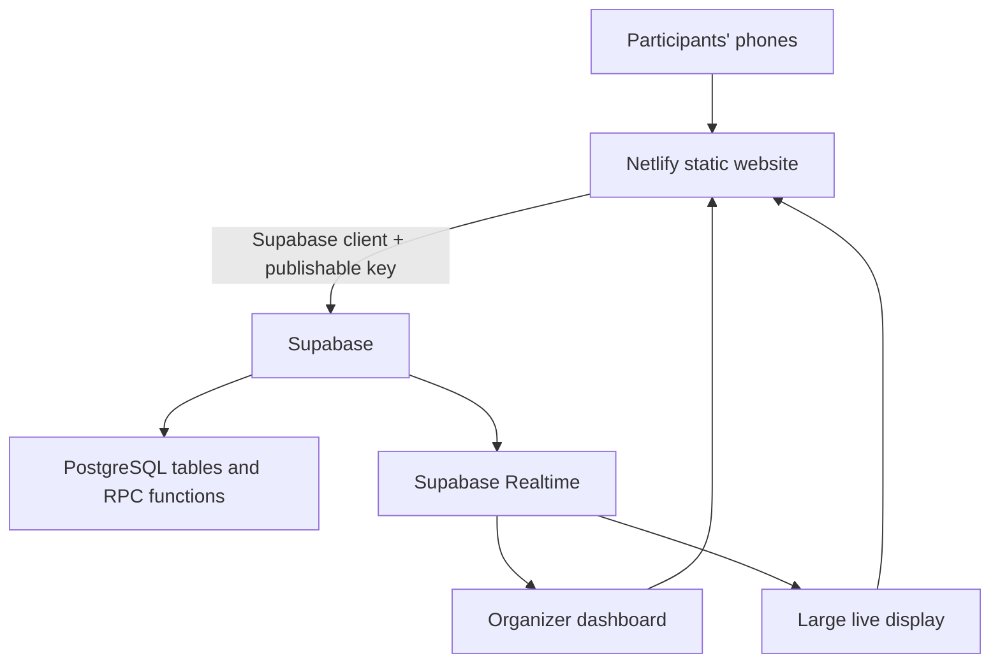

# من يعرف عُمان أكثر؟ | Oman National Day Event

An Arabic-first, real-time cultural quiz experience built for an Oman National Day event. Participants join from their phones using a QR code, answer questions through interactive cards, and follow the competition on a large live display.

**Project contributors:** Faisal Al Breiki & Juhaina Al Subhi

**Event presentation:** [مسكد Heritage – Canva presentation](https://canva.link/r3j89e9c2c3vdut)  
The presentation includes the **المسابقة الثقافية (Cultural Quiz)** segment.

---

## Project overview

The project contains three connected interfaces:

| Interface | File | Purpose |
|---|---|---|
| Participant | `public/index.html` | Mobile-first registration and quiz experience |
| Organizer dashboard | `public/admin.html` | Competition controls, participant management, statistics, activity feed, and CSV export |
| Live display | `public/screen.html` | Large-screen status, live activity, countdown, and winner announcement |

The website is designed for an in-person event: participants scan a QR code, register with a display name, and answer from their own phones while the organizer controls the competition.

## Features

- QR-code access to the participant page.
- Arabic, mobile-first participant interface.
- Nine question cards; participants can choose any three or more.
- One attempt per question card.
- Answer validation performed by PostgreSQL functions in Supabase.
- Organizer login using Supabase Authentication and an authorized-admin table.
- Live participant count, started count, reserved winners, and activity feed.
- Participant deletion is available only while registration is open.
- Registration closes when the organizer starts the competition.
- The first three participants to qualify are reserved as winners, while the competition remains open until the organizer ends it.
- Winner reveal is controlled manually from the organizer dashboard.
- The live display shows friendly activity updates without exposing winner rankings before the reveal.
- Participants see their own final result after the competition closes.
- CSV export for competition results.
- Separate background and winner-announcement audio tracks.

## Technology

- HTML5
- CSS3
- Vanilla JavaScript
- Supabase: PostgreSQL, Authentication, RPC functions, and Realtime
- Netlify for static hosting

## Architecture



## Repository structure

```text
oman-national-day-quiz/
├── demo/
│   └── demo-data.js
├── public/
│   ├── index.html
│   ├── admin.html
│   ├── screen.html
│   ├── styles.css
│   ├── js/
│   │   ├── config.js
│   │   ├── backend.js
│   │   ├── participant.js
│   │   ├── admin.js
│   │   └── screen.js
│   └── assets/
│       ├── audio/
│       └── images/
├── supabase/
│   ├── schema.sql
│   └── migration scripts
├── netlify.toml
├── package.json
└── README.md
```

## Run locally (Demo mode)

The repository is configured for local Demo mode by default. Demo data is stored in `demo/demo-data.js`.

1. Install Python 3 if it is not already installed.
2. Open a terminal in the repository root.
3. Start a local static server:

   ```bash
   python -m http.server 8000
   ```

4. Open these pages:

   - Participant: <http://localhost:8000/public/index.html>
   - Organizer: <http://localhost:8000/public/admin.html>
   - Live display: <http://localhost:8000/public/screen.html>

5. Demo organizer PIN: `1400`.

Demo mode is intended for local demonstration only. It uses browser storage and does not synchronize participants across separate devices.

## Connect a Supabase project

The checked-in `public/js/config.js` contains placeholders and enables Demo mode so that the repository does not point to the original event database.

To connect your own Supabase project:

1. Create a Supabase project.
2. For a **new database only**, run `supabase/schema.sql` once in the Supabase SQL Editor.
3. Create an organizer account under **Authentication → Users**.
4. Add that user's Auth UUID to `public.admin_users`:

   ```sql
   insert into public.admin_users (user_id)
   values ('YOUR-AUTH-USER-UUID');
   ```

5. Open `public/js/config.js` and set your project URL and **publishable** key. Then set `DEMO_MODE` to `false`:

   ```js
   window.APP_CONFIG = {
     DEMO_MODE: false,
     SUPABASE_URL: "https://YOUR-PROJECT.supabase.co",
     SUPABASE_PUBLISHABLE_KEY: "YOUR_SUPABASE_PUBLISHABLE_KEY",
     POLL_INTERVAL_MS: 2500,
     DEMO_ADMIN_PIN: "1400"
   };
   ```

6. Deploy the `public/` directory using Netlify.

**Existing Supabase database:** Do not run `schema.sql` over a database that already contains competition data. Use only the migration that matches the database's current version, and back up important data before applying migrations.

### Security notes

- The browser must use a Supabase **publishable** key (or legacy `anon` public key) only.
- Never put a Supabase `secret` or `service_role` key in frontend JavaScript, HTML, or a public GitHub repository.
- Keep `DEMO_MODE: false` for a real Supabase deployment.
- Organizer access is checked against the authorized-admin records in Supabase.
- Participant registration uses a display name; it is not identity verification.

## Deploy to Netlify

The included `netlify.toml` sets the publish directory to `public/`.

For a Git-based deployment:

1. Push this repository to GitHub.
2. In Netlify, choose **Add new site → Import an existing project**.
3. Connect the GitHub repository.
4. Confirm the publish directory is `public`.
5. Before deploying a real event, configure `public/js/config.js` with your own Supabase project and set `DEMO_MODE` to `false`.

Do not deploy the repository in Demo mode for a live competition.

## Audio assets

The application expects these files under `public/assets/audio/`:

- `live.mp3` — looping background music during the competition.
- `win.mp3` — one-time winner-announcement music.

Only publish audio files that you created or have permission to redistribute. The project code and audio instructions are retained; check the rights for the actual music files before making the repository public.

## Event credit

This project was developed for the **Cultural Quiz (المسابقة الثقافية)** segment of the event presentation.

**Faisal Al Breiki & Juhaina Al Subhi**

[Open the event presentation in Canva](https://canva.link/r3j89e9c2c3vdut)

